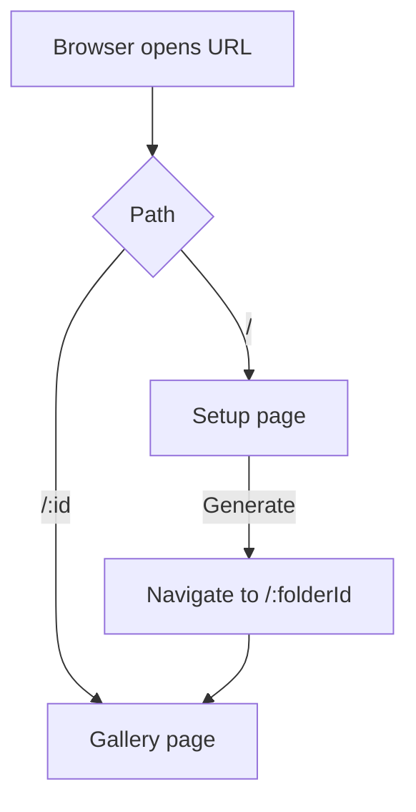
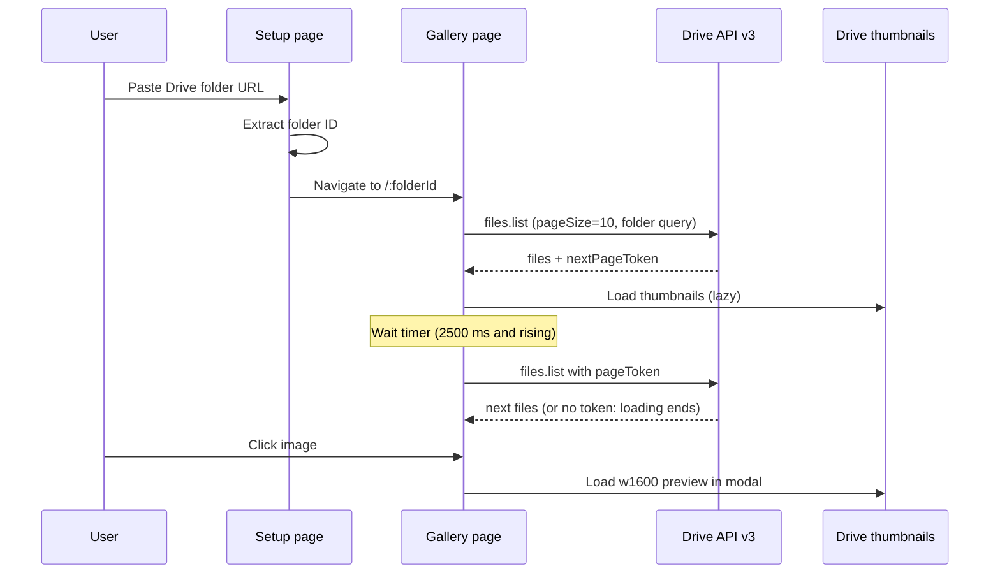

# Architecture

This page describes how the app is structured, how it talks to the Google Drive API, and where to make changes. For setup, see [Getting started](getting-started.md). For the API key, see [Configuration and security](configuration.md). For the project overview, see the [README](../README.md).

## Stack

- React 19 with `react-router` 8 for routing
- Vite 8 for dev server and builds, using `@vitejs/plugin-react` and the React Compiler through `@rolldown/plugin-babel` (set in `vite.config.js`)
- Tailwind CSS 4 through `@tailwindcss/vite`
- ESLint 10 with the React hooks and React refresh plugins (`eslint.config.js`)

There is no backend. The browser calls the Google Drive API directly.

## Project layout

```
src/
  main.jsx            Entry point. Renders <Route /> inside StrictMode.
  Router.jsx          Defines the two routes. Both pages are lazy-loaded.
  pages/
    Setup.jsx         Home page. Takes a Drive folder URL and opens the gallery.
    Gallery.jsx       Loads, paginates, and displays the images in a folder.
  components/
    Modal.jsx         Full-size preview overlay.
  index.css           Global styles and Tailwind import.
public/               Favicons, manifest, and the Open Graph image.
```

## Routes

`src/Router.jsx` uses `createBrowserRouter` with two routes:

| Path | Component | Notes |
| --- | --- | --- |
| `/` | `Setup` | Home page with the URL input |
| `/:id` | `Gallery` | `id` is the Drive folder ID |

Both components are loaded with `React.lazy`, so each page is a separate chunk in the build output.



## Setup page

`Setup.jsx` contains `getDriveFolderId(url)`, which applies this regular expression to the pasted text:

```js
/\/folders\/([^/?]+)/
```

It captures the segment after `/folders/`. When you click **Generate**, the page navigates to `/<captured id>`.

If the text doesn't match, the function returns `null`, and the app navigates to `/null`. The Gallery then requests a folder called `null`, which fails or returns nothing. The page doesn't show an input error. See [Troubleshooting](troubleshooting.md).

## Gallery page

`Gallery.jsx` reads the folder ID from the route with `useParams`, then calls the Drive v3 files endpoint from a `useEffect`.

### Drive API request

Endpoint: `https://www.googleapis.com/drive/v3/files`

| Parameter | Value | Purpose |
| --- | --- | --- |
| `key` | `VITE_API_KEY` | Authenticates the request |
| `q` | `'<folderId>' in parents and mimeType contains 'image/' and trashed=false` | Image files directly inside the folder, not in the trash |
| `fields` | `nextPageToken,files(id,name,mimeType)` | Returns only the fields the app uses |
| `pageSize` | `10` | Ten files per request |
| `pageToken` | Last value in `pagetokens` | Set for every page after the first |

The `q` query only looks at files directly inside the folder. It doesn't include subfolders.

### Images

Each file is shown as a thumbnail:

```
https://drive.google.com/thumbnail?id=<fileId>&sz=w800
```

The preview in the modal uses `sz=w1600`. The download button links to:

```
https://drive.google.com/uc?export=download&id=<fileId>
```

Google does not document the `thumbnail` and `uc` URLs in the Drive v3 reference. They may change without notice.

### State

| State | Purpose |
| --- | --- |
| `images` | All files loaded so far, appended on each page |
| `pagetokens` | Tokens for each next page. Adding a token triggers the next request. |
| `isloading` | `true` until a response has no `nextPageToken` |
| `timeouttime` | Delay in milliseconds before the next page is requested |
| `selectedimageid` | ID of the image open in the modal, or `null` |

### Pagination timing

The first page is requested right away. Each later page is requested after a timer. The timer works as follows, as read from the code:

- The delay starts at 2500 ms.
- After each page, the delay is set to `2500 + ((previous + 100) % 2500)`. This adds 100 ms each time and wraps back to 2500 ms.
- The delay is read from the render that started the request. This means each wait uses the value from the previous page's render.

In practice, waits go 2500 ms, 2600 ms, 2700 ms, and so on up to 4900 ms, then back to 2500 ms. This was derived from the code and not measured at runtime.



## Modal

`Modal.jsx` renders its children into `document.body` with `createPortal`, so it sits above the page. It's only rendered when `isOpen` is true.

- **Escape** closes it. A `keydown` listener handles this.
- **Browser back** closes it. The modal pushes a history entry when it opens, and a `popstate` listener closes it.
- **Clicking the dark backdrop** closes it. Clicks inside the panel are stopped from reaching the backdrop.

The modal has no close button.

## Entry point and build

`src/main.jsx` mounts `<Route />` inside `StrictMode`. In development, StrictMode runs effects twice, so the Gallery's first request can run twice. Production builds run it once.

`vite.config.js` registers the Tailwind plugin, the React plugin, and the React Compiler preset. The React Compiler adds some build time, which is expected.

## Where to make changes

| Task | File |
| --- | --- |
| Add or change a route | `src/Router.jsx` |
| Change how a Drive URL is parsed | `getDriveFolderId` in `src/pages/Setup.jsx` |
| Change the query, page size, or fields | The `url.searchParams` calls in `src/pages/Gallery.jsx` |
| Change the loading delay | The `setTimeout` block in `src/pages/Gallery.jsx` |
| Change the thumbnail size | The `sz` value in `src/pages/Gallery.jsx` |
| Change the modal behavior | `src/components/Modal.jsx` |
